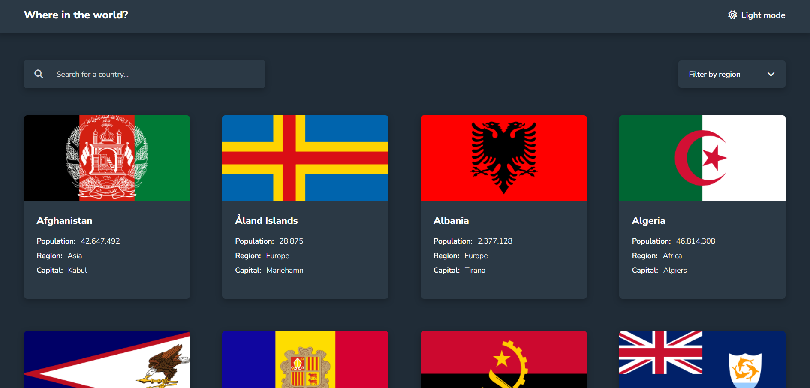

# 🌍 REST Countries Explorer

An interactive web application that allows users to explore countries around the world.

## 📸 Screenshot

## 🚀 Live Demo

[View the Live Demo](https://omarabdelkhaliq.github.io/REST-Countries/)

## ✨ Features

- Browse countries around the world.
- Search for countries by name.
- Filter countries by region.
- View detailed information about each country.
- Switch between light and dark modes.
- Responsive design for different screen sizes.

## 🛠️ Built With

- HTML5
- CSS3
- JavaScript
- REST Countries API

## 📚 What I Learned

- Fetching data from an API using JavaScript.
- Working with asynchronous JavaScript.
- Dynamically displaying data in the DOM.
- Implementing search and filtering functionality.
- Managing light and dark themes.

## 👨‍💻 Author

**Omar Abdelkhaliq**

- GitHub: [@omarabdelkhaliq](https://github.com/omarabdelkhaliq)
- LinkedIn: [Connect with me](https://www.linkedin.com/in/omar-abdel-khaliq-027180242/)
